A live solar system of my repos, rebuilt every day from my GitHub activity.

## Reading the orbit

**The system**

| | |
|:-:|---|
| ☀️ | **The sun** is me. |
| 🪐 | **Planets** are my repos. Closer to the sun means pushed more recently. Bigger means more stars and more code. |
| 🎨 | **Colour** is the repo's main language, in GitHub's own language colours (see below). |
| 🌙 | **Moons** are releases (gold) and open issues and PRs (grey). |
| ⚡ | **Beams** connect repos that belong together. They light up when the planets pass close by. |
| 🪨 | **The asteroid belt** holds the rest of my repos. |
| 🌑 | **Grey planets with craters** haven't been touched in half a year. |

**What's happening now**

| | |
|:-:|---|
| 🌋 | **A volcano**: I pushed to that repo in the last 24 hours. |
| 🔥 | **Solar flares**: I made 15+ commits in the last 24 hours. |
| ☄️ | **The comet** carries my latest commit. |
| 🛰️ | **A satellite**: the repo's GitHub Actions ran in the last two days. Green passed, red failed, amber is still running. |
| 🚩 | **A flag** shows a release from the last week. On everythingyouneed it's the live site's version. |
| 📡 | **A dish** means the repo has a GitHub Pages site. |

**Visitors**

| | |
|:-:|---|
| 🚀 | **Spaceships** are people who contributed to a repo, taking turns to visit it. |
| 🌠 | **Shooting stars** are people who starred a repo this week. |
| 📊 | **The space station** carries my last two weeks of contributions on its solar wings. |
| 🎆 | **Fireworks** celebrate a milestone reached this week, like a round number of stars, followers or contributors. |

**Languages in the orbit**

<picture>
  <source media="(prefers-color-scheme: dark)" srcset="assets/legend-dark.svg">
  <source media="(prefers-color-scheme: light)" srcset="assets/legend-light.svg">
  
</picture>
